<div align="center">

# Habita · Frontend

**Diseño de interiores con inteligencia artificial y modelado 3D.**

Proyecto final de **Patrones de Diseño**


</div>

## ¿En qué consiste?

**Habita** permite tomar o subir una foto de un espacio, elegir un estilo y ver cómo quedaría rediseñado por la IA, armar el espacio en un editor 3D con muebles reales del catálogo, calcular un presupuesto y guardar proyectos. **Lumi**, la asistente, guía al usuario por voz o texto.

| Componente | Repositorio                                                             | Producción                                          |
| ---------- | ----------------------------------------------------------------------- | --------------------------------------------------- |
| Frontend   | [decora-ia-frontend](https://github.com/Santiago425/decora-ia-frontend) | https://decora-ia-frontend.vercel.app               |
| Backend    | [decora-ia-backend](https://github.com/Santiago425/decora-ia-backend)   | https://decora-ia-backend.onrender.com/api/v1/hello |

## Capturas

Tomadas de la app desplegada en Vercel con la cuenta de prueba.

| Login con acceso de prueba                                   | Inicio                                                   |
| ------------------------------------------------------------ | -------------------------------------------------------- |
|                          |                 |
| **Rediseño con foto (antes / después)**                      | **Ediciones puntuales sobre el rediseño**                |
| 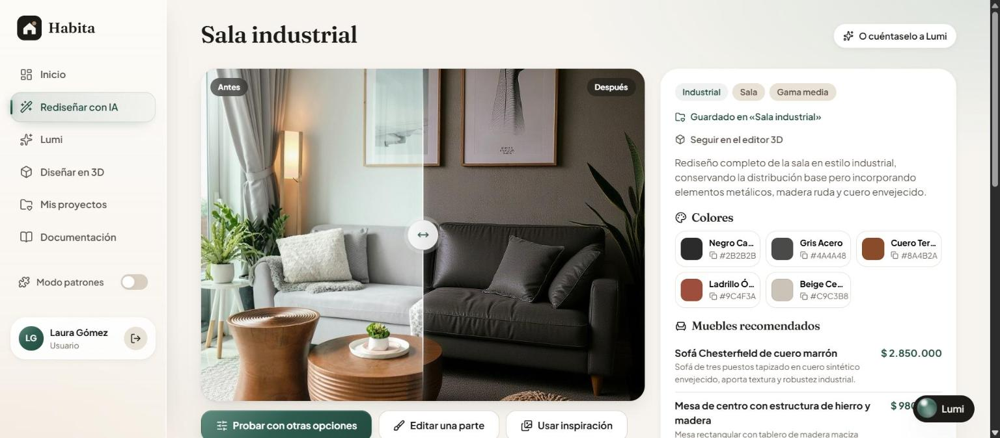                   | 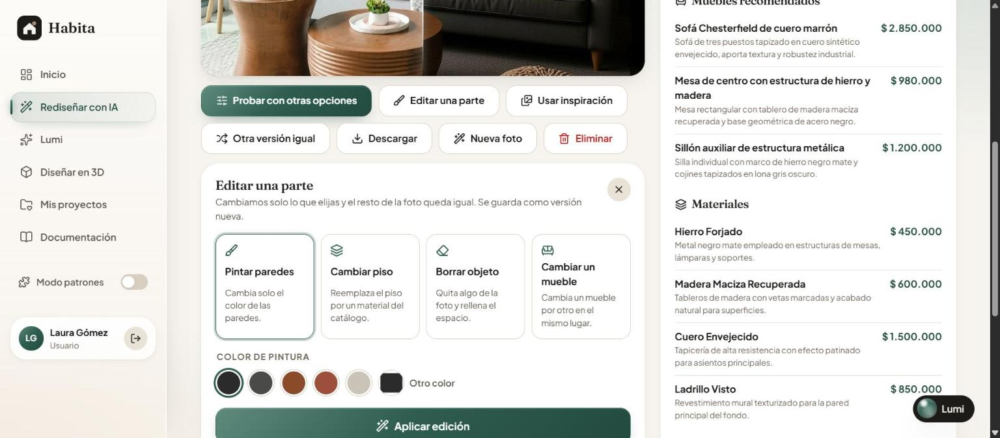   |
| **Editor 3D**                                                | **Mis proyectos con su foto**                            |
| 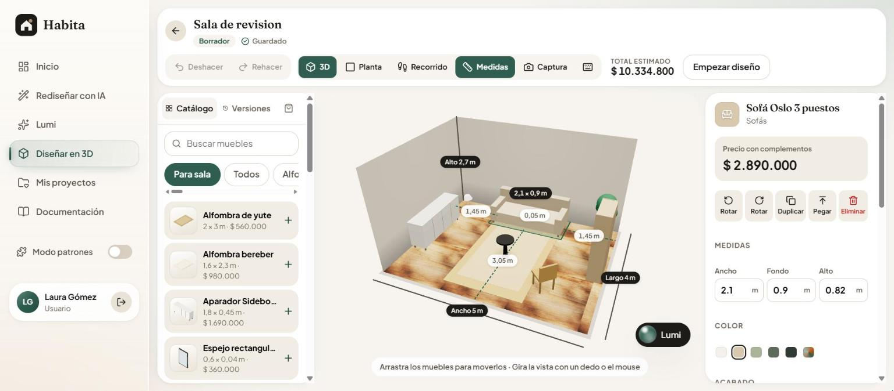                 | 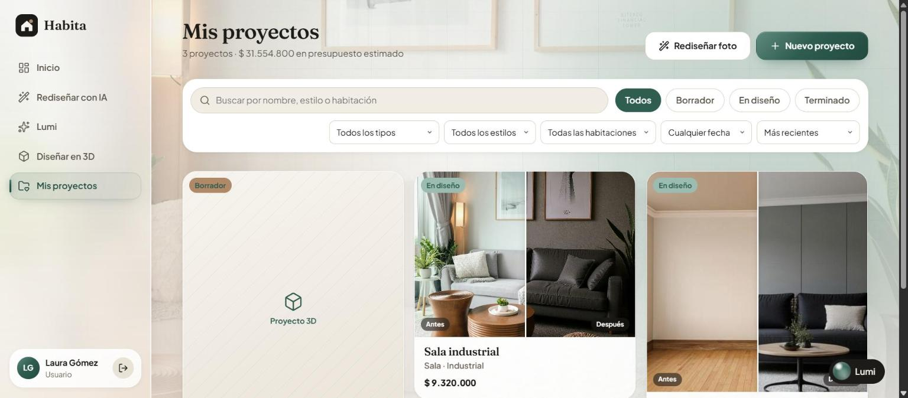     |
| **Estilo desde una foto de inspiración**                     | **Panel de administración**                              |
| 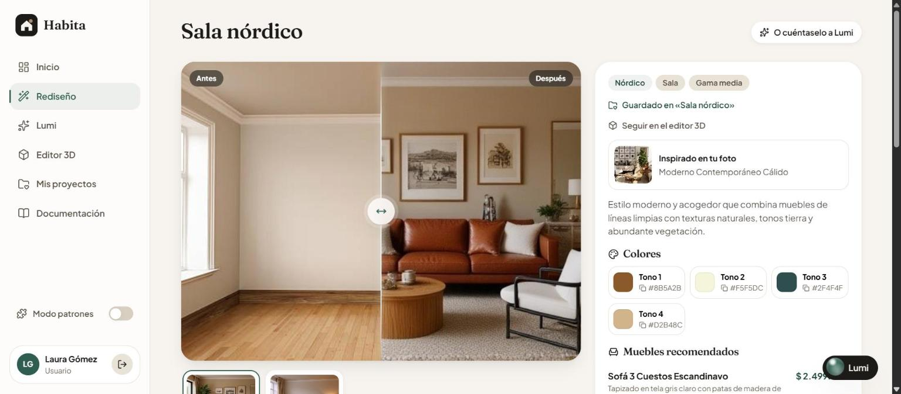             |             |
| **Modo patrones en el editor**                               | **Ficha de un patrón con demo y UML**                    |
| 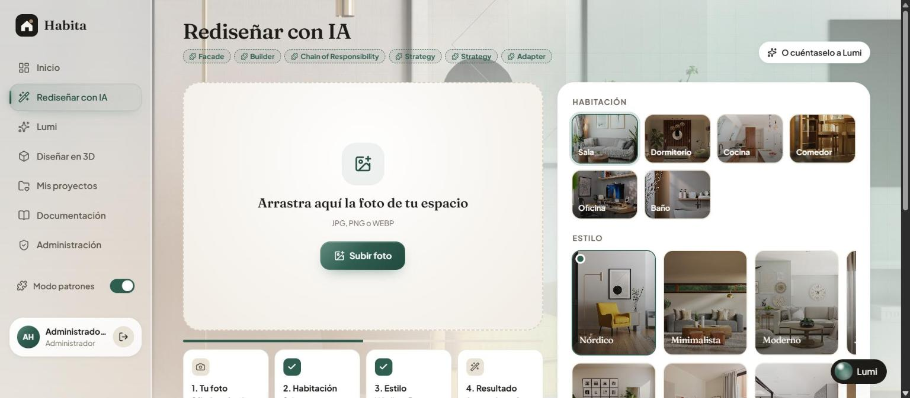         | 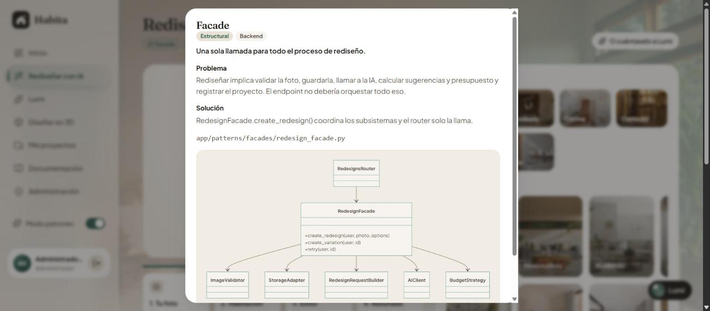    |
| **Lumi**                                                     | **Lumi ejecutando órdenes en el editor**                 |
|                            | 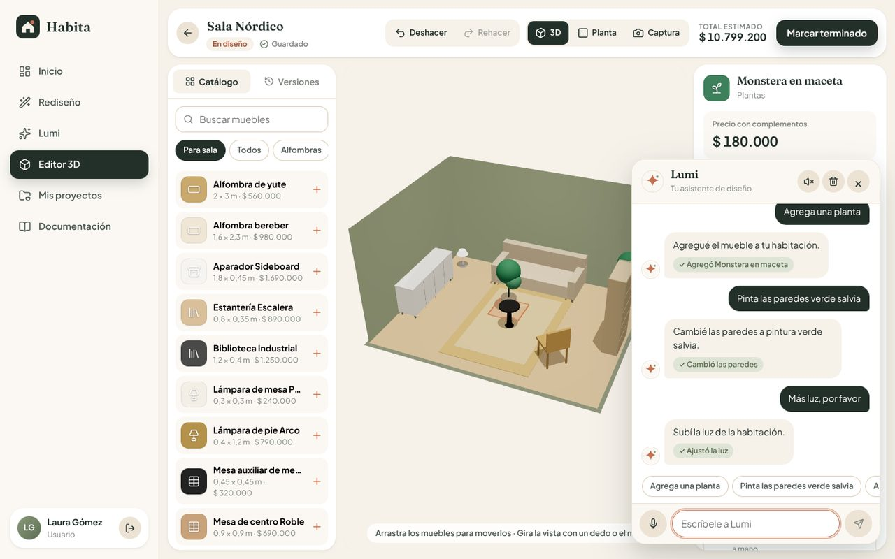   |
| **Documentación**                                            | **Principios SOLID**                                     |
| 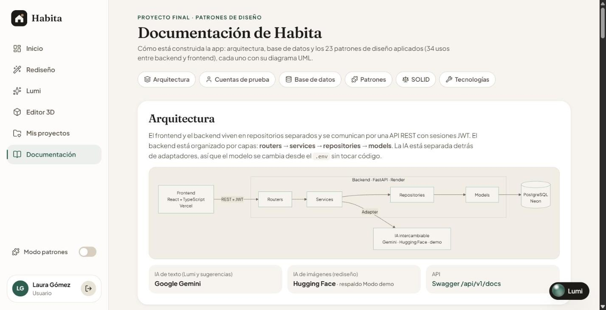         | 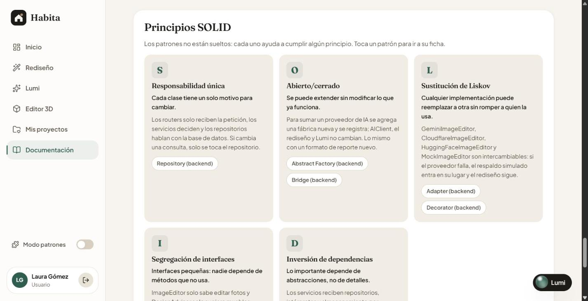                     |
| **Inicio en el celular**                                     | **Lumi en el celular**                                   |
|  | 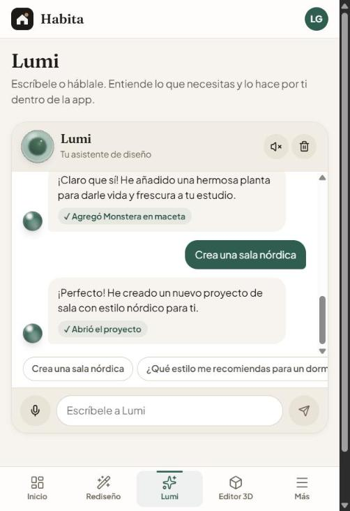 |

## Funcionalidades

| Sección                   | Qué hace                                                                                                                                                                                                                     |
| ------------------------- | ---------------------------------------------------------------------------------------------------------------------------------------------------------------------------------------------------------------------------- |
| **Login y registro**      | Login con selector Usuario / Administrador, validaciones en vivo, sesión con JWT y **acceso de prueba** con un clic (las cuentas salen del backend).                                                                         |
| **Inicio**                | Resumen de proyectos, rediseños, estilo favorito y presupuesto, con gráfica de estilos y actividad reciente.                                                                                                                 |
| **Rediseño con foto**     | Sube o toma una foto con la cámara del celular, elige habitación, estilo, paleta y presupuesto; la IA devuelve la imagen rediseñada, colores, muebles y materiales con precio. Comparador antes / después y variaciones.     |
| **Estilo desde una foto** | Sobre un rediseño: subir una foto de un espacio que guste; la IA describe su estilo, colores y materiales y ese texto se aplica a la foto como una versión nueva, marcada «Inspirado en tu foto».                            |
| **Ediciones puntuales**   | Sobre un rediseño: pintar paredes, cambiar el piso, borrar un objeto o cambiar un mueble sin tocar el resto de la foto. Opción para respetar el cuarto real (paredes, ventanas y puertas) y elegir muebles que se conservan. |
| **Editor 3D**             | Arma la habitación con muebles del catálogo: mover, rotar, duplicar, agrupar, colores, acabados y complementos, deshacer y rehacer, vista de planta, captura, versiones y guardado automático.                               |
| **Lumi**                  | Asistente por voz o texto. Entiende lo que pides y lo hace: crea proyectos, te lleva al rediseño, agrega muebles, pinta paredes, cambia la luz o deshace cambios. Puede leer sus respuestas en voz alta.                     |
| **Mis proyectos**         | Buscar, filtrar por estado o tipo, ordenar, renombrar, duplicar y eliminar. Cada proyecto con foto muestra su antes / después y lo abre al tocarlo.                                                                          |
| **Administración**        | Solo para administradores: métricas de la plataforma, usuarios (rol y activación), catálogo (precios, muebles nuevos, estilos y complementos visibles) y reportes CSV.                                                       |
| **Modo patrones**         | Interruptor del menú: cada pantalla muestra qué patrones usa; al tocar uno se abre su ficha con problema, solución, una demo interactiva y el diagrama UML.                                                                  |
| **Documentación**         | Arquitectura, cuentas de prueba, diagrama entidad relación, cada patrón con su problema, solución, archivos y diagrama UML (Mermaid), y los principios SOLID con los patrones que los cumplen.                               |

## Guía rápida para la evaluación

1. Abrir https://decora-ia-frontend.vercel.app (si el backend estuvo dormido, el primer ingreso tarda unos segundos en Render).
2. Entrar como **Usuario** con el botón de _Acceso de prueba_ (o con `usuario@habita.app` / `Habita2026`).
3. **Rediseño:** subir una foto de una sala, elegir _Japandi_ y ver el antes / después con su presupuesto.
4. **Editor 3D:** abrir un proyecto, mover un mueble, agregarle cojines y probar _Deshacer_ (Ctrl + Z).
5. **Lumi:** tocar el botón flotante y decir o escribir _"agrega una planta"_ y _"pinta las paredes verde salvia"_.
6. **Estilo desde una foto:** en el rediseño, tocar _Usar inspiración_, subir una foto que guste y _Aplicar este estilo_.
7. **Ediciones puntuales:** en el rediseño, tocar _Editar una parte_ y pintar las paredes de otro color.
8. **Modo patrones:** activar el interruptor del menú y tocar un patrón para ver su ficha, su demo y su UML.
9. **Documentación:** mostrar los patrones con sus diagramas UML, los principios SOLID y el diagrama de la base de datos.
10. Cerrar sesión y entrar como **Administrador** con `admin@habita.app` / `Habita2026` para ver métricas, usuarios, catálogo y reportes.

## Patrones aplicados en el frontend

| Patrón               | Tipo           | Dónde                                                                      | Para qué                                                                                                                                                                                           |
| -------------------- | -------------- | -------------------------------------------------------------------------- | -------------------------------------------------------------------------------------------------------------------------------------------------------------------------------------------------- |
| **Singleton**        | Creacional     | [`src/services/apiClient.ts`](src/services/apiClient.ts)                   | Un único cliente HTTP con el token de la sesión para toda la app.                                                                                                                                  |
| **Observer**         | Comportamiento | [`src/services/notificationCenter.ts`](src/services/notificationCenter.ts) | Cualquier parte de la app publica un aviso y los suscriptores (como el `Toaster`) reaccionan sin conocerse entre sí.                                                                               |
| **Proxy**            | Estructural    | [`src/components/ImageProxy.tsx`](src/components/ImageProxy.tsx)           | Ocupa el lugar de la imagen real: la carga solo cuando entra en pantalla y muestra un marcador mientras tanto.                                                                                     |
| **Command**          | Comportamiento | [`src/editor/commands.ts`](src/editor/commands.ts)                         | Agregar, mover, rotar, eliminar, cambiar color o complementos, agrupar y restaurar versiones son objetos que saben aplicarse y revertirse: así funcionan deshacer y rehacer (Ctrl + Z / Ctrl + Y). |
| **Factory Method**   | Creacional     | [`src/editor/furnitureFactory.ts`](src/editor/furnitureFactory.ts)         | Cada tipo de mueble (sofá, cama, mesa, silla, lámpara, planta…) tiene su fábrica que decide de qué piezas 3D está hecho; la forma viene de la categoría guardada en la base de datos.              |
| **Composite**        | Estructural    | [`src/editor/composite.ts`](src/editor/composite.ts)                       | Un mueble, un grupo de muebles y la habitación completa se cotizan, cuentan, mueven y duplican de la misma forma.                                                                                  |
| **Prototype**        | Creacional     | [`src/editor/composite.ts`](src/editor/composite.ts)                       | Duplicar un mueble o un grupo clona la pieza con identificadores nuevos.                                                                                                                           |
| **Decorator**        | Estructural    | [`src/editor/furnitureDecorators.ts`](src/editor/furnitureDecorators.ts)   | Cojines, manta, cubierta de vidrio, patas de latón o luz LED envuelven al mueble y le suman precio y apariencia sin modificar su clase.                                                            |
| **Abstract Factory** | Creacional     | [`src/editor/styleTheme.ts`](src/editor/styleTheme.ts)                     | `StyleThemeFactory`: cada estilo produce una familia coherente de luz, acabado de paredes, piso y colores de acento.                                                                               |
| **Observer**         | Comportamiento | [`src/editor/editorStore.ts`](src/editor/editorStore.ts)                   | El lienzo 3D, los paneles y la barra de herramientas se suscriben al estado del editor y se actualizan cuando cambia la escena.                                                                    |
| **Adapter**          | Estructural    | [`src/assistant/voiceAdapter.ts`](src/assistant/voiceAdapter.ts)           | `VoiceAdapter` envuelve el reconocimiento de voz y la síntesis del navegador (con nombres distintos según el navegador) en una interfaz simple: escuchar, hablar y detener.                        |
| **Observer**         | Comportamiento | [`src/assistant/assistantBus.ts`](src/assistant/assistantBus.ts)           | Lumi publica sus acciones y quien puede ejecutarlas se suscribe: el enrutador abre páginas y proyectos, el editor 3D agrega muebles, cambia paredes, luz o estilo y deshace.                       |
| **Strategy**         | Comportamiento | [`src/projects/projectQuery.ts`](src/projects/projectQuery.ts)             | Mis proyectos se ordena por fecha, nombre o presupuesto: cada orden es una estrategia intercambiable.                                                                                              |
| **Observer**         | Comportamiento | [`src/assistant/chatStore.ts`](src/assistant/chatStore.ts)                 | El chat flotante y la página de Lumi comparten la misma conversación y se mantienen sincronizados.                                                                                                 |

## Cuentas de prueba

| Rol           | Correo               | Contraseña   |
| ------------- | -------------------- | ------------ |
| Usuario       | `usuario@habita.app` | `Habita2026` |
| Administrador | `admin@habita.app`   | `Habita2026` |

Las crea el script de semilla del backend; la contraseña sale de la variable `DEMO_PASSWORD`.

## Ejecutar en local

```bash
npm install
cp .env.example .env
npm run dev        # http://localhost:5173
npm run lint       # ESLint (typescript-eslint, react-hooks, jsx-a11y)
npm run format     # Prettier
npm test
npm run build
```

Con Docker (sirve la app compilada con nginx):

```bash
docker build -t habita-frontend --build-arg VITE_API_URL=http://localhost:8000 .
docker run -p 8080:80 habita-frontend      # http://localhost:8080
```

## Calidad

- **107 pruebas** con Vitest:
  - **Lógica:** comandos de deshacer / rehacer, fábricas de muebles, composite, mediador del editor, filtros y orden de proyectos, bus de Lumi, conversación, adaptador de voz, modo patrones, formatos y validaciones.
  - **Interfaz** (Testing Library + jsdom): botones, pestañas con teclado, paginador, campos de formulario, diálogo de confirmación, acceso de prueba, rutas protegidas y el flujo completo del login.
- **ESLint** (typescript-eslint, react-hooks, jsx-a11y) y **Prettier** sin advertencias.
- **Integración continua** con GitHub Actions: en cada push y pull request se ejecutan lint, formato, pruebas, compilación y la imagen de Docker.
- Revisión manual en PC y celular antes de la entrega.
- Despliegue automático en **Vercel** desde `main`, con cabeceras de seguridad (CSP, HSTS, permisos de cámara y micrófono) en [`vercel.json`](vercel.json).

## Variables de entorno

Todas están documentadas en [`.env.example`](.env.example) y se leen en un único módulo: [`src/config.ts`](src/config.ts).

| Variable                                                                               | Para qué                                                                               |
| -------------------------------------------------------------------------------------- | -------------------------------------------------------------------------------------- |
| `VITE_APP_NAME`                                                                        | Nombre de la app en la interfaz                                                        |
| `VITE_ASSISTANT_NAME`                                                                  | Nombre de la asistente (el reconocimiento y la voz usan `VITE_LOCALE`)                 |
| `VITE_API_URL` / `VITE_API_PREFIX`                                                     | Dirección del backend                                                                  |
| `VITE_REQUEST_TIMEOUT_MS`                                                              | Tiempo máximo de espera de una petición                                                |
| `VITE_AI_TIMEOUT_MS`                                                                   | Tiempo máximo de espera de un rediseño con IA                                          |
| `VITE_MAX_PHOTO_SIDE`                                                                  | Tamaño máximo al que se reduce la foto antes de subirla                                |
| `VITE_CURRENCY` / `VITE_LOCALE`                                                        | Moneda y formato de precios                                                            |
| `VITE_EDITOR_SNAP`, `VITE_EDITOR_MOVE_STEP`, `VITE_EDITOR_ROTATE_STEP`                 | Cuadrícula, paso al mover con flechas y grados al rotar en el editor 3D                |
| `VITE_EDITOR_HISTORY_LIMIT`, `VITE_EDITOR_AUTOSAVE_MS`, `VITE_EDITOR_DUPLICATE_OFFSET` | Pasos que se pueden deshacer, espera del guardado automático y separación de una copia |
| `VITE_AUTH_IMAGE_URL`                                                                  | Foto de fondo del login                                                                |
| `VITE_DASHBOARD_BANNER_URL`                                                            | Foto del banner del inicio                                                             |
| `VITE_DASHBOARD_BACKDROP_URL` / `VITE_EMPTY_STATE_IMAGE_URL`                           | Foto de fondo del inicio y foto de los estados vacíos                                  |
| `VITE_PHOTO_INTERVAL_MS`                                                               | Tiempo que se muestra cada foto de un carrusel                                         |
| `VITE_DEV_PORT`                                                                        | Puerto del servidor de desarrollo                                                      |
| `VITE_PHOTO_CREDITS_NAME` / `VITE_PHOTO_CREDITS_URL`                                   | Créditos de las fotos                                                                  |

## Estructura

```
src/
├── config.ts        Configuración leída de VITE_*
├── pages/           Login, Register, Dashboard…
├── components/layout/ Menú lateral y menú inferior del celular
├── components/dashboard/ Tarjetas, gráfica, actividad y proyectos
├── components/editor/ Lienzo 3D (React Three Fiber), catálogo, propiedades y versiones
├── editor/          Lógica del editor 3D: comandos, fábricas, composite, decoradores, temas
├── components/admin/ Panel de administración: resumen, usuarios, catálogo y reportes
├── components/docs/ Diagramas UML con Mermaid
├── docs/            Contenido de la sección Documentación (patrones, arquitectura, diagrama ER)
├── projects/        Búsqueda, filtros y orden de Mis proyectos
├── components/assistant/ Chat de Lumi, botón flotante y ejecutor de acciones
├── assistant/       Voz (Adapter), bus de acciones y conversación (Observer)
├── patterns/        Modo patrones: qué patrones usa cada pantalla
├── routes/          Páginas con carga diferida
├── test/            Configuración de las pruebas de interfaz
├── components/ui/   Botón, pestañas, paginador, modal y otras piezas compartidas
├── components/      Piezas reutilizables de la interfaz
├── context/         Sesión del usuario
├── hooks/           Hooks propios
├── services/        Cliente API y servicios
├── styles/          Tokens de diseño y estilos
├── types/           Tipos compartidos
└── utils/           Validaciones
```

## Equipo

| Integrante          | GitHub                                         |
| ------------------- | ---------------------------------------------- |
| Santiago Campoverde | [@Santiago425](https://github.com/Santiago425) |
| Never Melo          | [@neber18](https://github.com/neber18)         |
