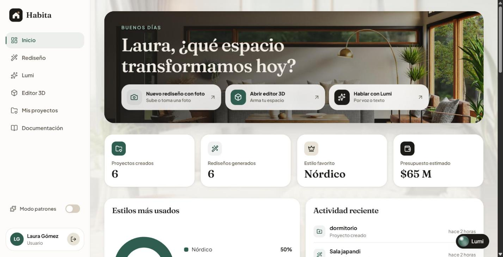
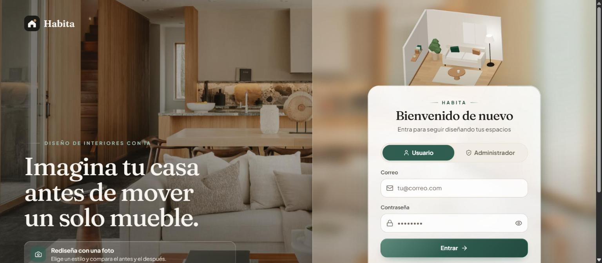
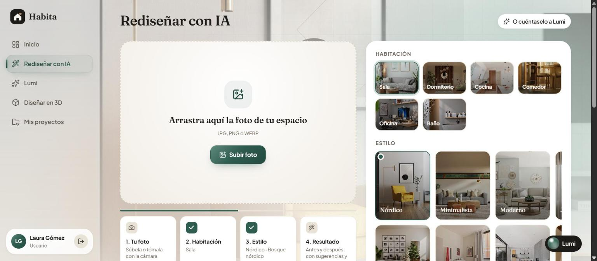
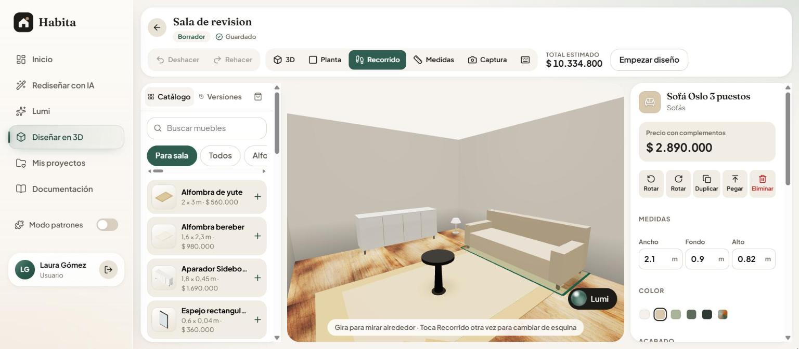
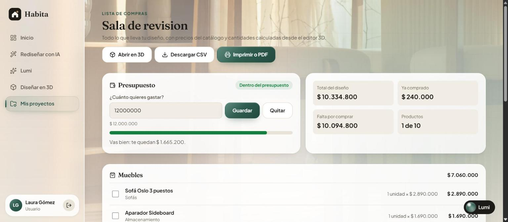
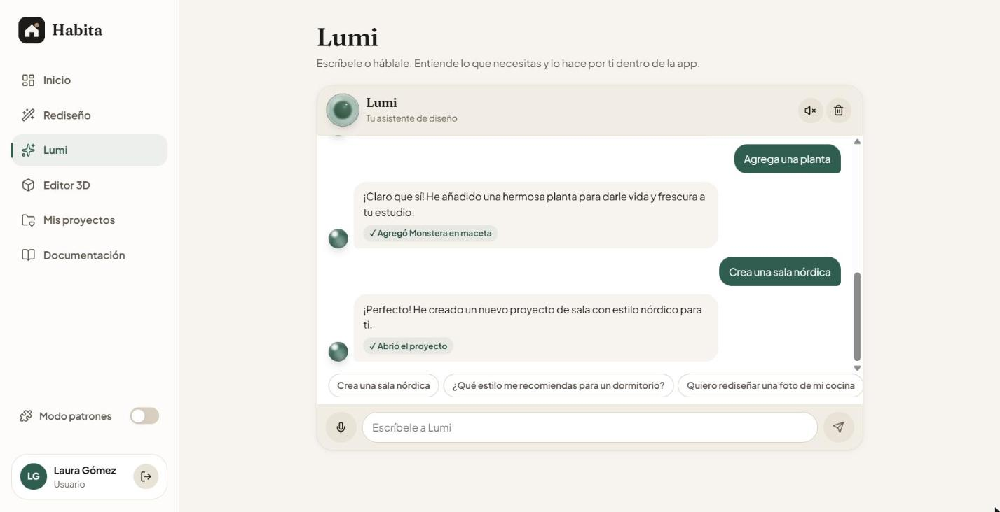
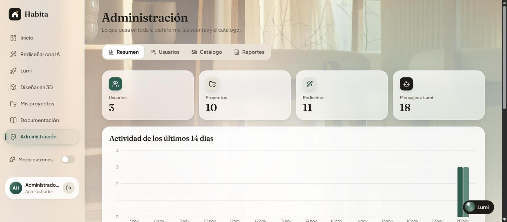
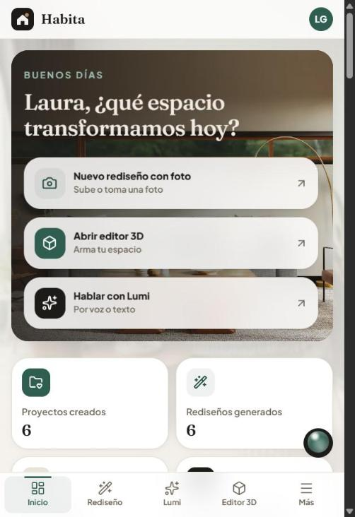
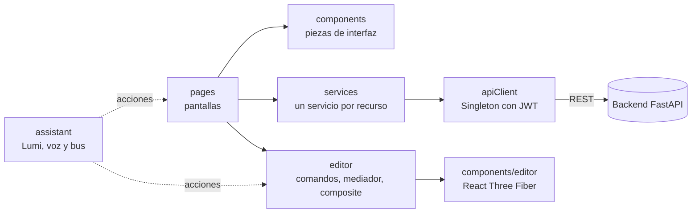

<div align="center">


# Habita · Frontend

**Diseño de interiores con inteligencia artificial y modelado 3D.**

Proyecto final de **Patrones de Diseño**

[**Abrir la app**](https://decora-ia-frontend.vercel.app) · [Backend](https://github.com/Santiago425/decora-ia-backend) · [API (Swagger)](https://decora-ia-backend.onrender.com/api/v1/docs)


</div>



## Contenido

- [¿En qué consiste?](#en-qué-consiste)
- [Capturas](#capturas)
- [Funcionalidades](#funcionalidades)
- [Guía rápida para la evaluación](#guía-rápida-para-la-evaluación)
- [Patrones aplicados en el frontend](#patrones-aplicados-en-el-frontend)
- [Arquitectura](#arquitectura)
- [Calidad](#calidad)
- [Ejecutar en local](#ejecutar-en-local)
- [Variables de entorno](#variables-de-entorno)
- [Estructura](#estructura)
- [Equipo](#equipo)

## ¿En qué consiste?

**Habita** permite tomar o subir una foto de un espacio, elegir un estilo y ver cómo quedaría rediseñado por la IA, armar el espacio en un editor 3D con muebles reales del catálogo, sacar la lista de compras con su presupuesto y guardar todo como proyectos. **Lumi**, la asistente, guía al usuario por voz o texto y ejecuta lo que se le pide dentro de la app.

| Componente | Repositorio                                                             | Producción                                          |
| ---------- | ----------------------------------------------------------------------- | --------------------------------------------------- |
| Frontend   | [decora-ia-frontend](https://github.com/Santiago425/decora-ia-frontend) | https://decora-ia-frontend.vercel.app               |
| Backend    | [decora-ia-backend](https://github.com/Santiago425/decora-ia-backend)   | https://decora-ia-backend.onrender.com/api/v1/hello |

| Rol           | Correo               | Contraseña   |
| ------------- | -------------------- | ------------ |
| Usuario       | `usuario@habita.app` | `Habita2026` |
| Administrador | `admin@habita.app`   | `Habita2026` |

En el login también está el **acceso de prueba**: un clic y se entra con cualquiera de las dos cuentas. Las crea el script de semilla del backend y la contraseña sale de la variable `DEMO_PASSWORD`.

## Capturas

Tomadas de la app desplegada en Vercel con las cuentas de prueba.

### En el computador

| Login con acceso de prueba                            | Rediseñar con IA                                                    |
| ----------------------------------------------------- | ------------------------------------------------------------------- |
|                   |  |
| **Rediseño real con FLUX Kontext: antes y después**   | **Ediciones puntuales sobre el rediseño**                           |
|             |     |
| **Editor 3D con medidas y un mueble seleccionado**    | **Recorrido a la altura de los ojos**                               |
|           |                         |
| **Lista de compras con presupuesto**                  | **Mis proyectos con filtros**                                       |
|      |                 |
| **Lumi**                                              | **Estilo desde una foto de inspiración**                            |
|                     |                     |
| **Panel de administración**                           | **Modo patrones (administradores)**                                 |
|          |                 |
| **Ficha de un patrón con su UML**                     | **Documentación y principios SOLID**                                |
|  |                                 |

### En el celular

<!-- mobile-gallery -->

| Inicio                                                       | Lumi                                                     |
| ------------------------------------------------------------ | -------------------------------------------------------- |
|  |  |

<!-- /mobile-gallery -->

## Funcionalidades

| Sección                   | Qué hace                                                                                                                                                                                                                                                                                       |
| ------------------------- | ---------------------------------------------------------------------------------------------------------------------------------------------------------------------------------------------------------------------------------------------------------------------------------------------- |
| **Login y registro**      | Login sobre fotos de interiores con un cuarto 3D, selector Usuario / Administrador, validaciones en vivo, sesión con JWT y **acceso de prueba** con un clic (las cuentas salen del backend).                                                                                                   |
| **Inicio**                | Saludo con accesos directos, totales (proyectos, rediseños, estilo favorito, presupuesto), últimos proyectos con su antes / después, progreso por estado, galería de inspiración en coverflow y los **17 estilos** del catálogo.                                                               |
| **Rediseñar con IA**      | Sube o toma una foto con la cámara del celular, elige habitación, estilo, paleta y presupuesto. **FLUX Kontext** (Hugging Face) devuelve la foto rediseñada y Gemini los colores, muebles y materiales con precio. Comparador antes / después, otra versión, versiones por proyecto y borrado. |
| **Ediciones puntuales**   | Sobre un rediseño: pintar paredes, cambiar el piso, borrar un objeto o cambiar un mueble sin tocar el resto de la foto. Opción para respetar el cuarto real (paredes, ventanas y puertas) y elegir muebles que se conservan.                                                                   |
| **Estilo desde una foto** | Se sube una foto de un espacio que guste; la IA describe su estilo, colores y materiales y ese texto se aplica a la foto como una versión nueva, marcada «Inspirado en tu foto».                                                                                                               |
| **Errores claros**        | Si el proveedor de imágenes falla o devuelve la misma foto, la app lo dice y ofrece reintentar, en vez de mostrar una copia como si fuera un rediseño.                                                                                                                                         |
| **Diseñar en 3D**         | Proyecto nuevo con tipo de habitación, estilo y **medidas del cuarto** (o tamaños rápidos). El catálogo sugiere los muebles **del tipo de habitación**. Mover, rotar, duplicar, agrupar, **cambiar el tamaño**, pegar a la pared, colores, acabados y complementos; deshacer y rehacer.        |
| **Medidas y recorrido**   | Guías de medidas con distancias a las paredes, aviso cuando dos muebles **se cruzan**, vista de planta, **recorrido** a la altura de los ojos desde cada esquina, **tono de luz**, captura, versiones y guardado automático.                                                                   |
| **Lista de compras**      | Cada proyecto saca su lista: muebles, complementos y acabados con cantidades calculadas desde la escena y precios del catálogo. Presupuesto con medidor, marcar lo ya comprado, incluir las ideas del rediseño, descarga en CSV e impresión o PDF.                                             |
| **Lumi**                  | Asistente por voz o texto. Entiende lo que pides y lo hace: crea proyectos, te lleva al rediseño, agrega muebles, pinta paredes, cambia la luz o deshace cambios. Puede leer sus respuestas en voz alta.                                                                                       |
| **Mis proyectos**         | Buscar, filtrar por estado, tipo, estilo, habitación y fecha, ordenar, renombrar, duplicar, ir a la lista de compras y eliminar. Cada proyecto con foto muestra su antes / después y lo abre al tocarlo.                                                                                       |
| **Administración**        | Solo para administradores: métricas de la plataforma, usuarios (rol y activación), catálogo (precios, muebles nuevos, estilos y complementos visibles) y reportes CSV / JSON.                                                                                                                  |
| **Modo patrones**         | Para administradores: un interruptor del menú muestra qué patrones usa cada pantalla; al tocar uno se abre su ficha con problema, solución, una demo interactiva y el diagrama UML.                                                                                                            |
| **Documentación**         | Para administradores: arquitectura, cuentas de prueba, diagrama entidad relación, los 23 patrones con su problema, solución, archivos y diagrama UML (Mermaid), y los principios SOLID con los patrones que los cumplen.                                                                       |
| **Diseño visual**         | Paleta lino con acento salvia (`#2f5d50`), tarjetas de vidrio esmerilado, fondo de fotos de interiores animado detrás de cada página, intro 3D, tarjetas con inclinación y volteo, y carga diferida de cada página.                                                                            |
| **Celular**               | Menú inferior con «Más», cámara para la foto, editor 3D con panel deslizable desde abajo y todas las secciones adaptadas a pantallas pequeñas.                                                                                                                                                 |

## Guía rápida para la evaluación

1. Abrir https://decora-ia-frontend.vercel.app (si el backend estuvo dormido, el primer ingreso tarda unos segundos en Render).
2. Entrar como **Usuario** con el botón de _Acceso de prueba_.
3. **Rediseño:** subir una foto de una sala, elegir _Industrial_ y ver el antes / después con su presupuesto. Probar _Otra versión igual_ o _Probar con otras opciones_.
4. **Ediciones puntuales:** en el rediseño, tocar _Editar una parte_ y pintar las paredes de otro color.
5. **Estilo desde una foto:** en el rediseño, tocar _Usar inspiración_, subir una foto que guste y _Aplicar este estilo_.
6. **Editor 3D:** en _Diseñar en 3D_ crear una sala de 5 × 4 m, tocar el sofá, activar _Medidas_, cambiarle el tamaño, probar _Recorrido_ y _Deshacer_ (Ctrl + Z).
7. **Lista de compras:** desde el editor o desde _Mis proyectos_, abrir la bolsa, fijar un presupuesto y marcar algo como comprado.
8. **Lumi:** tocar el botón flotante y decir o escribir _"agrega una planta"_ y _"pinta las paredes verde salvia"_.
9. Cerrar sesión y entrar como **Administrador** para ver métricas, usuarios, catálogo y reportes.
10. Como administrador, activar **Modo patrones** en el menú y tocar un patrón para ver su ficha, su demo y su UML; luego abrir **Documentación** para los diagramas, los principios SOLID y la base de datos.

## Patrones aplicados en el frontend

El proyecto aplica **23 patrones** en **36 usos** entre los dos repositorios. Estos son los del frontend; los del backend están en su [README](https://github.com/Santiago425/decora-ia-backend#patrones-aplicados).

| Patrón               | Tipo           | Dónde                                                                                                        | Para qué                                                                                                                                                                                     |
| -------------------- | -------------- | ------------------------------------------------------------------------------------------------------------ | -------------------------------------------------------------------------------------------------------------------------------------------------------------------------------------------- |
| **Singleton**        | Creacional     | [`src/services/apiClient.ts`](src/services/apiClient.ts)                                                     | Un único cliente HTTP con el token de la sesión para toda la app.                                                                                                                            |
| **Factory Method**   | Creacional     | [`src/editor/furnitureFactory.ts`](src/editor/furnitureFactory.ts)                                           | Cada tipo de mueble (sofá, cama, mesa, silla, lámpara, planta…) tiene su fábrica que decide de qué piezas 3D está hecho; la forma viene de la categoría guardada en la base de datos.        |
| **Abstract Factory** | Creacional     | [`src/editor/styleTheme.ts`](src/editor/styleTheme.ts)                                                       | `StyleThemeFactory`: cada estilo produce una familia coherente de luz, acabado de paredes, piso y colores de acento.                                                                         |
| **Prototype**        | Creacional     | [`src/editor/composite.ts`](src/editor/composite.ts)                                                         | Duplicar un mueble o un grupo clona la pieza con identificadores nuevos.                                                                                                                     |
| **Composite**        | Estructural    | [`src/editor/composite.ts`](src/editor/composite.ts)                                                         | Un mueble, un grupo de muebles y la habitación completa se cotizan, cuentan, mueven y duplican de la misma forma.                                                                            |
| **Decorator**        | Estructural    | [`src/editor/furnitureDecorators.ts`](src/editor/furnitureDecorators.ts)                                     | Cojines, manta, cubierta de vidrio, patas de latón o luz LED envuelven al mueble y le suman precio y apariencia sin modificar su clase.                                                      |
| **Adapter**          | Estructural    | [`src/assistant/voiceAdapter.ts`](src/assistant/voiceAdapter.ts)                                             | `VoiceAdapter` envuelve el reconocimiento de voz y la síntesis del navegador (con nombres distintos según el navegador) en una interfaz simple: escuchar, hablar y detener.                  |
| **Proxy**            | Estructural    | [`src/components/ImageProxy.tsx`](src/components/ImageProxy.tsx)                                             | Ocupa el lugar de la imagen real: la carga solo cuando entra en pantalla y muestra un marcador mientras tanto.                                                                               |
| **Proxy virtual**    | Estructural    | [`src/utils/lazyWithPreload.ts`](src/utils/lazyWithPreload.ts), [`src/routes/pages.ts`](src/routes/pages.ts) | Cada página se descarga solo cuando hace falta, y se adelanta al pasar el mouse o el dedo por su enlace.                                                                                     |
| **Command**          | Comportamiento | [`src/editor/commands.ts`](src/editor/commands.ts)                                                           | Agregar, mover, rotar, cambiar tamaño, eliminar, cambiar color o complementos, agrupar y restaurar versiones son objetos que saben aplicarse y revertirse: así funcionan deshacer y rehacer. |
| **Mediator**         | Comportamiento | [`src/editor/editorMediator.ts`](src/editor/editorMediator.ts)                                               | El lienzo, el catálogo, el inspector, el teclado y Lumi no se hablan entre sí: todos pasan por `EditorMediator`, que decide qué comando ejecutar y qué panel mostrar.                        |
| **Strategy**         | Comportamiento | [`src/projects/projectQuery.ts`](src/projects/projectQuery.ts)                                               | Mis proyectos se ordena por fecha, nombre o presupuesto: cada orden es una estrategia intercambiable.                                                                                        |
| **Observer**         | Comportamiento | [`src/services/notificationCenter.ts`](src/services/notificationCenter.ts)                                   | Cualquier parte de la app publica un aviso y los suscriptores (como el `Toaster`) reaccionan sin conocerse entre sí.                                                                         |
| **Observer**         | Comportamiento | [`src/editor/editorStore.ts`](src/editor/editorStore.ts)                                                     | El lienzo 3D, los paneles y la barra de herramientas se suscriben al estado del editor y se actualizan cuando cambia la escena.                                                              |
| **Observer**         | Comportamiento | [`src/assistant/assistantBus.ts`](src/assistant/assistantBus.ts)                                             | Lumi publica sus acciones y quien puede ejecutarlas se suscribe: el enrutador abre páginas y proyectos, el editor 3D agrega muebles, cambia paredes, luz o estilo y deshace.                 |
| **Observer**         | Comportamiento | [`src/assistant/chatStore.ts`](src/assistant/chatStore.ts)                                                   | El chat flotante y la página de Lumi comparten la misma conversación y se mantienen sincronizados.                                                                                           |

## Arquitectura



- **Nada quemado:** textos de la marca, URL del backend, tiempos, medidas del editor, moneda y fotos salen de [`src/config.ts`](src/config.ts), que lee las variables `VITE_*`; el catálogo, los estilos y los precios vienen del backend.
- **Carga diferida:** cada página y las piezas pesadas (Three.js, Mermaid, gráficas) van en su propio paquete.
- **Accesibilidad:** navegación con teclado en pestañas y diálogos, etiquetas en todos los controles y `eslint-plugin-jsx-a11y` en el CI.

## Calidad

- **206 pruebas** en 48 archivos con Vitest:
  - **Interfaz** (Testing Library + jsdom), con los flujos principales de punta a punta: **login** (validaciones, error del servidor, acceso de prueba), **rediseño** (foto, habitación y estilo, antes / después, error y reintento, nueva versión), **editor 3D** (muebles sugeridos, agregar, deshacer y rehacer, eliminar, guardado automático, órdenes de Lumi, solo lectura), **Lumi** (historial, mensajes, sugerencias que ejecutan acciones, borrar), **Mis proyectos** (filtros, renombrar, duplicar, eliminar) y **administración** (totales, roles, activar cuentas, reportes). También botones, pestañas con teclado, paginador, formularios, diálogos, rutas protegidas y la lista de compras.
  - **Lógica:** comandos de deshacer / rehacer, fábricas de muebles, composite, mediador del editor, guías de medidas y choques, recorrido, filtros y orden de proyectos, bus de Lumi, conversación, adaptador de voz, modo patrones, formatos y validaciones.
- **ESLint** (typescript-eslint, react-hooks, jsx-a11y) y **Prettier** sin advertencias.
- **Integración continua** con GitHub Actions: en cada push y pull request se ejecutan lint, formato, pruebas, compilación y la imagen de Docker.
- Revisión manual en PC y celular de la app desplegada.
- Despliegue automático en **Vercel** desde `main`, con cabeceras de seguridad (CSP, HSTS, permisos de cámara y micrófono) en [`vercel.json`](vercel.json).

## Ejecutar en local

```bash
npm install
cp .env.example .env
npm run dev        # http://localhost:5173
npm run lint       # ESLint (typescript-eslint, react-hooks, jsx-a11y)
npm run format     # Prettier
npm test           # Vitest
npm run build
```

Con Docker (sirve la app compilada con nginx):

```bash
docker build -t habita-frontend --build-arg VITE_API_URL=http://localhost:8000 .
docker run -p 8080:80 habita-frontend      # http://localhost:8080
```

## Variables de entorno

Todas están documentadas en [`.env.example`](.env.example) y se leen en un único módulo: [`src/config.ts`](src/config.ts).

| Variable                                                                                 | Para qué                                                                               |
| ---------------------------------------------------------------------------------------- | -------------------------------------------------------------------------------------- |
| `VITE_APP_NAME`                                                                          | Nombre de la app en la interfaz                                                        |
| `VITE_ASSISTANT_NAME`                                                                    | Nombre de la asistente (el reconocimiento y la voz usan `VITE_LOCALE`)                 |
| `VITE_API_URL` / `VITE_API_PREFIX`                                                       | Dirección del backend                                                                  |
| `VITE_REQUEST_TIMEOUT_MS` / `VITE_AI_TIMEOUT_MS`                                         | Tiempo máximo de espera de una petición normal y de un rediseño con IA                 |
| `VITE_MAX_PHOTO_SIDE`                                                                    | Tamaño máximo al que se reduce la foto antes de subirla                                |
| `VITE_CURRENCY` / `VITE_LOCALE`                                                          | Moneda y formato de precios                                                            |
| `VITE_EDITOR_SNAP`, `VITE_EDITOR_MOVE_STEP`, `VITE_EDITOR_ROTATE_STEP`                   | Cuadrícula, paso al mover con flechas y grados al rotar en el editor 3D                |
| `VITE_EDITOR_HISTORY_LIMIT`, `VITE_EDITOR_AUTOSAVE_MS`, `VITE_EDITOR_DUPLICATE_OFFSET`   | Pasos que se pueden deshacer, espera del guardado automático y separación de una copia |
| `VITE_EDITOR_OVERLAP_TOLERANCE`, `VITE_EDITOR_EYE_HEIGHT`                                | Margen para avisar que dos muebles se cruzan y altura de la cámara en el recorrido     |
| `VITE_EDITOR_WINDOW_SILL`                                                                | Altura desde el piso a la que empiezan las ventanas en el editor 3D                    |
| `VITE_ROOM_SIZE_PRESETS`                                                                 | Tamaños rápidos del cuarto al crear un proyecto 3D                                     |
| `VITE_EDITOR_RESIZE_MIN_FACTOR` / `VITE_EDITOR_RESIZE_MAX_FACTOR`                        | Cuánto puede encogerse o crecer un mueble respecto a su tamaño de catálogo             |
| `VITE_AUTH_IMAGE_URL`, `VITE_SIDEBAR_PHOTO_URL`, `VITE_PAGE_BACKDROP_URL`                | Fotos del login, de la tarjeta del menú y del fondo animado de cada página             |
| `VITE_DASHBOARD_BANNER_URL`, `VITE_DASHBOARD_BACKDROP_URL`, `VITE_EMPTY_STATE_IMAGE_URL` | Fotos del banner del inicio, de los estados vacíos y de la página 404                  |
| `VITE_PHOTO_WIDTHS`, `VITE_PHOTO_DEFAULT_WIDTH`, `VITE_PHOTO_QUALITY`                    | Anchos y calidad con que se piden las fotos de fondo para que se vean nítidas          |
| `VITE_PHOTO_INTERVAL_MS`                                                                 | Tiempo que se muestra cada foto de un carrusel                                         |
| `VITE_RECENT_REDESIGNS_LIMIT`                                                            | Cuántos rediseños recientes se muestran debajo del formulario                          |
| `VITE_PHOTO_CREDITS_NAME` / `VITE_PHOTO_CREDITS_URL`                                     | Créditos de las fotos                                                                  |
| `VITE_DEV_PORT`                                                                          | Puerto del servidor de desarrollo                                                      |

## Estructura

```
src/
├── config.ts                 Configuración leída de VITE_*
├── navigation.ts             Menú lateral y menú inferior (con los roles que ven cada sección)
├── pages/                    Una pantalla por ruta, con sus pruebas de interfaz
├── routes/                   Páginas con carga diferida (Proxy virtual)
├── components/
│   ├── layout/               Menú lateral, menú inferior del celular y fondo animado
│   ├── dashboard/            Tarjetas, progreso y proyectos del inicio
│   ├── redesign/             Foto, opciones, comparador, versiones, ediciones e inspiración
│   ├── editor/               Lienzo 3D (React Three Fiber), catálogo, inspector, habitación y versiones
│   ├── assistant/            Chat de Lumi, botón flotante y esfera 3D
│   ├── admin/                Resumen, usuarios, catálogo y reportes
│   ├── patterns/, docs/      Modo patrones, fichas, demos y diagramas UML con Mermaid
│   ├── three/, motion/       Escenas 3D del login y la intro, inclinación, volteo y coverflow
│   └── ui/                   Botón, pestañas, paginador, chips y otras piezas compartidas
├── editor/                   Lógica del editor: comandos, mediador, composite, fábricas, decoradores, temas
├── assistant/                Voz (Adapter), bus de acciones y conversación (Observer)
├── projects/, shopping/      Búsqueda, filtros y rutas de proyectos; lista de compras
├── patterns/, docs/          Qué patrones usa cada pantalla y contenido de la Documentación
├── services/                 Cliente API (Singleton) y un servicio por recurso
├── context/, hooks/          Sesión del usuario y hooks propios
├── styles/                   Tokens de diseño y estilos por sección
├── test/                     Configuración compartida de las pruebas de interfaz
├── types/                    Tipos compartidos
└── utils/                    Formatos, medidas, fotos y validaciones
```

## Equipo

| Integrante          | GitHub                                         |
| ------------------- | ---------------------------------------------- |
| Santiago Campoverde | [@Santiago425](https://github.com/Santiago425) |
| Never Melo          | [@neber18](https://github.com/neber18)         |
